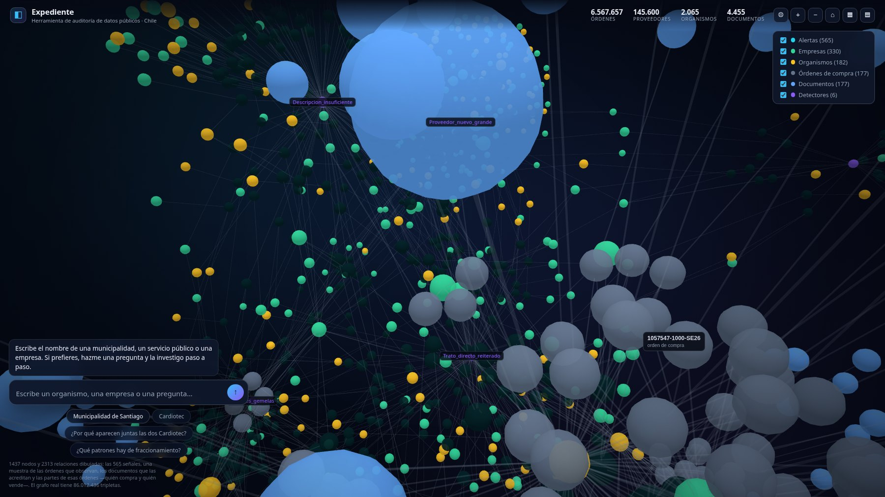
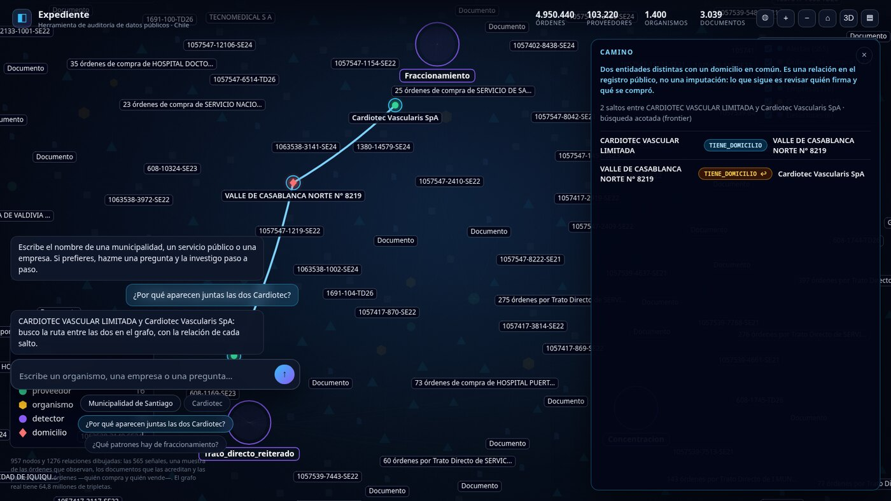

# Expediente

[](https://github.com/SebaWag/expediente/actions/workflows/ci.yml)
[](https://www.python.org/downloads/)
[](LICENSE)
[](pyproject.toml)

**A verifiable evidence engine for public procurement.**

> Every finding in an Expediente dossier is footnoted to the exact document and page.
> If a claim cannot be traced to a source, it is deleted, not softened.

Built for the **Meta Global AI Developer Hackathon 2026** (Startup track, theme *Build for Your World*).





<sub>Asking *"why do the two Cardiotec appear together?"* returns a walk, not a paragraph: the field
dims to 6%, the route is drawn hop by hop with the relation on each edge, and every hop goes
against the stored direction of `TIENE_DOMICILIO` exactly once — which is what makes it a shared
address and not a shared buyer.</sub>

## What a person does in it

Four moves, and none of them is "read a chat answer":

1. **Ask.** *"¿Por qué aparecen juntas las dos Cardiotec?"* — the portal recognises a connection
   question, finds both suppliers, and answers with a walk instead of a paragraph.
2. **Look at the route.** The rest of the field dims to 6 %, the path is drawn hop by hop with the
   relation named on each edge, and the panel states the finding with its limit attached: *"a
   relation in the public record, not an imputation."*
3. **Watch the run.** The step log is a waterfall: the model's own time and tokens in one colour,
   graph work in another, a deleted claim in red — and a closing line that reads
   **`8 pasos · 44.732 tok · 16,8 s (96% modelo)`**.
4. **Rewind it.** Drag the timeline and the canvas repaints what had happened by that point.
   **No model, no network, no database** — it re-reads the recording, it does not re-run it.

Every one of those four is driven by data that exists: a route is a query, a bar is a measured
duration, a red ring is a claim the gate deleted, and the scrubber replays a recording. The
interface is not allowed to claim more than the run does.

<sub>The live portal at <a href="https://investiga.wagnersolutionsai.com">investiga.wagnersolutionsai.com</a> — the landing draws the 565 signals and the documents that back them, and reads its totals from the graph every time. No number in this line can go stale, because no number in this line is a literal.</sub>

---

## The Meta agent: what lets a neighbour audit the State

The graph is not the product. **67,307,606 triples** are, today, unusable by the people the data
belongs to. Not because the records are closed — they are public — but because the interface is
SPARQL. A council member, a journalist or a Contraloría analyst does not write SPARQL, and does
not have three weeks to learn.

Muse Spark is the layer that closes that distance. Not by summarising documents — by **driving a
graph**.

### One real run, measured

| | |
|---|---|
| Question (typed in Spanish, by a person) | *"¿Qué patrones hay de fraccionamiento?"* |
| Steps | **8** |
| Model calls | 9 |
| Tokens | 45.414 (42.050 in · 3.364 out · 2.437 reasoning) |
| Wall clock | **48,5 s** |
| Stopped by | `terminar` — **the model's own decision**, not a step limit |
| Claims accepted | 1, each with a document |
| Dossier | `sha256:340de350dc96…` (content-derived, re-derivable) |

The plan it wrote, verbatim, before touching anything:

```
buscar_en_grafo para ubicar organismos y proveedores vinculados a fraccionamiento
senales_de para listar las señales que mencionan fraccionamiento por entidad
senal_detalle para ver las órdenes, montos y documentos de cada señal
perfil_de_gasto para ver cuánto y por qué vía compró cada organismo involucrado
```

Those are four real verbs from the catalogue. The catalogue is generated from the tool schemas,
not written by hand — the first live run planned `buscar_proveedor` and `ver_vecinos_del_grafo`,
verbs that do not exist, because the plan call had no tool list to look at. That defect is why
`verb_catalogue()` exists.

### What the model actually does

1. **Plans** the investigation, naming tools that exist.
2. **Picks one verb per turn** and reads its result — 8 steps to a claim a human can sign.
3. **Decides when the evidence is enough**, and stops (`terminar` is a tool, not a timeout).
4. **Explains the finding in plain Spanish**, for someone who is not a programmer.
5. **Says what it could not sustain** before the reader finds out: if the evidence chain is
   incomplete, that caveat is part of the answer — the gate rejects the claim instead of softening it.

### The design decision that matters: it does not write SPARQL

This is deliberate, and it is the opposite of the obvious design.

| | Model writes queries | Model picks from 13 typed tools |
|---|---|---|
| Unbounded scan over 67 M triples | one bad query takes the service down | impossible: every tool compiles to a bounded traversal |
| Reproducibility | the same question can produce a different number | the number comes from code, and can be re-run |
| Steps needed | many, each one a chance to be wrong | 8 steps, because the vocabulary is small |
| Auditability | you audit a query you did not write | you audit a rule you can read |

The agent has exactly thirteen verbs — `buscar_en_grafo`, `vecinos`, `caminos`, `red_proveedor`,
`citas`, `senal_detalle`, `senales_de`, `perfil_de_gasto`, `documento_de_orden`, `buscar_en_web`,
`leer_fuente`, `afirmar`, `terminar`. The first nine compile to graph traversals with limits in
code. The last two are the ones that make it an investigation rather than a search: **`afirmar` is
the only way a conclusion enters the dossier**, and it refuses to write one without a node, a
document hash, or a verbatim quote.

So the division of labour is explicit: **the model decides what to look at next; the code decides
what is true.** A different model can replace Muse Spark without changing a single guarantee in
this table — which is the point of building a harness instead of a prompt.

### What that makes accessible

| Before | With the agent |
|---|---|
| To ask *"why did this municipality buy the same thing six times this month?"*: extract three archives, join by hand, and still not be able to prove the join | one sentence in Spanish, **48 seconds**, and a dossier where each order carries a document and a sha256 |
| The person who can answer is the one who can query | the person who can answer is the one who can read |
| Each new question needs a new dataset, a new analyst, a new week | the same thirteen verbs work on **2.065 buyers and 113.183 suppliers** — no per-entity engineering |

That is the scale claim, and it is not about the model doing more. It is that **the same interface
covers the whole country**, because the vocabulary is small enough for a model to use correctly and
the evidence contract is enforced by code, not by trust. A neighbour with a phone and a question
is, for the first time, equipped to produce the same artefact as an audit team.

### Build for Your World

As a citizen of the third world, I learned early that scarcity is not solved by having more. It is
solved by managing what you have, well. I am a single father of four daughters; I live that
arithmetic every month, with limited resources and a household that has to hold.

Expediente comes from there. If I have to account for every peso at home, I could not accept that a
municipality does not have to account for its own. And the difference is not that the State hides
its books — it is that they are unreadable: ten million purchase orders, archives nobody joins, and
an interface that assumes you know how to write a query.

So it was built for the people who have the question and not the query: a Contraloría auditor, a
prosecutor, a journalist, a council member, a neighbour. The same evidence, whoever asks.

> A frontier model is not what makes a finding true. It is what makes the finding **possible for
> someone who cannot write a query** — and that is the only version of this that scales.

## The problem

Chile publishes the full lifecycle of every public purchase — tenders, purchase orders, agile
purchases, contracts — through Mercado Público's open API, and the Contraloría publishes its audit
findings. The data exists in public.

What does not exist is the ability to **connect** it and **prove** it. To answer one question —
*"why did this municipality buy the same thing six times this month from the same supplier?"* — an
auditor, a journalist or a council member must cross-reference hundreds of documents by hand, and
then convince someone else that the cross-reference is right.

The State already has anomaly alerts. The gap is not detection. **The gap is a chain of evidence
that a human can sign.**

## What it does

Give it one entity — a buyer unit, a supplier, a tender — and it returns a dossier where every
claim carries a citation:

1. **Ingest** public records into a property graph (`:Organismo`, `:OrdenCompra`, `:Proveedor`,
   `:CompraAgil`, `:Licitacion`, `:Documento`, `:Evidencia`).
2. **Resolve entities** — the same supplier appears with RUT variants, punctuation differences,
   shared addresses and shared legal representatives. Resolution is a graph problem, not a string
   problem.
3. **Run deterministic detectors** — purchase splitting just below the bidding threshold, spend
   concentration, atypical direct awards, post-award contract growth, supplier co-bidding networks.
   A detector is a rule, and a rule is explainable and citable.
4. **Trace every finding** back to its source document and page, and drop the ones that cannot be
   traced.
5. **Benchmark against ground truth** — the Contraloría's published audit findings. *"The system
   independently rediscovered N of the M irregularities in report X, with correct citations."*

## Not a retrieval system. A navigation agent.

To be unambiguous: there is **no chunking, no embedding index, no vector store and no "ask the
documents" surface anywhere in this repository.** That architecture answers *"which paragraph
mentions X"*, which is not the question an auditor has.

Expediente is a **navigation agent**. It walks across datasets that were never joined, follows
typed edges between them, and produces the one thing none of those datasets contains on its own:
**a relation, with a citation**.

The datasets are all public. The joins are not:

| Dataset | Publisher | Joined to the rest today? |
|---|---|---|
| Purchase orders | ChileCompra | only by order code, inside its own file |
| `Compra Ágil` — including who quoted | ChileCompra | only by order code |
| Tenders and awards | ChileCompra | by tender code, when one exists |
| Contracts and modifications | ChileCompra | partially |
| Audit findings | Contraloría | **not at all** — PDFs, no identifiers |
| Ownership, legal representatives, addresses | company registries | **not at all** |

Nobody joins them because the join is not a foreign key. It is a **person** who appears as legal
representative of two suppliers. An **address** shared by three RUTs. A **sequence in time** —
seven orders that only mean something read together. Each of those requires a different kind of
traversal, and none of them is a similarity search over text.

So the agent has exactly three verbs:

| Verb | What it does | Why a retrieval system cannot |
|---|---|---|
| **Navigate** | chooses which edge to walk, and returns the path | a vector index has no edges to walk |
| **Relate** | asserts the connection between records that never referenced each other | similarity is not a relation |
| **Document** | attaches a document and a page to every assertion, or deletes the assertion | a chunk has a text span, not an accountable citation |

The path is the answer:

> A spreadsheet answers *how much*. A vector store answers *which text looks similar*.
> A graph answers **through whom** — and only that answer can be signed.

## Architecture

Frontier models only where they add something. Everything else is code.

| Layer | Runs on | Share of calls | Job |
|---|---|---|---|
| **0 · Deterministic** | Python + graph store | — | Ingest, normalise, detectors, aggregation, paths. Free, 100% citable. |
| **1 · Vision / OCR** | not built | — | Pages with no text layer. Declared as not started in *Status*, not claimed here. |
| **2a · Extraction** | Meta open weights (Muse Spark Open) | volume | Document → structured rows. Throughput is the whole constraint. |
| **2b · Agent** | Muse Spark, `reasoning_effort=low` | narrow | Plans the investigation and picks **one of 13 typed tools** per turn. Never writes a query. |
| **3 · Reasoning** | Muse Spark, `reasoning_effort=high` | ~5% | Synthesis of the dossier. One call per case. |

Two rules hold the design together:

- **The model returns data, never decisions.** Layer 2a turns a document into rows. Deterministic
  code decides what counts as an anomaly. No detector output can be hallucinated.
- **Prompt caching is a design constraint.** Tool schemas and the system prompt are stable so the
  cached prefix stays hot across turns.

## Graph model

See [`docs/GRAPH_SCHEMA.md`](docs/GRAPH_SCHEMA.md) for the full node and edge vocabulary.
The invariant that matters:

```
(:Afirmacion)-[:SOPORTADA_POR]->(:Evidencia)-[:EN]->(:Documento)
```

Any `:Afirmacion` without a path to a `:Documento` with a page number is **removed before export**.

## Repository layout

```
expediente/
  domain/       pure models and normalisers (no I/O, no network)
  ingest/       Mercado Público v1 + v2 clients, OCDS, bulk loaders
  graph/        graph schema, store interface, MillenniumDB adapter
  navigate/     RPQ route expressions and the tools an agent can call
  resolution/   entity resolution: shared address, shared representative
  detectors/    deterministic, explainable rules
  evidence/     the gate: what a dossier is allowed to say, PDF -> page
  extract/      fields with a page, or a named absence — never a finding
  dossier/      the signed artifact: citations, rejections, limitations
  agent/        the navigation agent: verbs, provider, plan/act/observe loop
  runs/         the append-only recording of a run, and its replay
  research/     web search, fetch, and the quote-must-exist rule
  mcp/          the graph tools, exposed over MCP for an external agent
  api/          the same tools over read-only HTTP
  portal/       the investigation UI: map, board, agent, log
  cli.py        command line entry point
scripts/        isolated MillenniumDB, ingest, deploy, signal materialisation
benchmarks/     entity resolution (1,249 pairs labelled by RUT) + the extraction harness
docs/           architecture, graph schema, backend dialect, findings
tests/          unit tests, deterministic, offline
examples/       small synthetic fixtures (fake data, clearly labelled)
```

## Quickstart

No dependencies. Python 3.11+ and the standard library are enough to run the deterministic core
and the tests:

```bash
git clone https://github.com/SebaWag/expediente
cd expediente

python3 -m pytest tests/ -q            # or: python3 -m unittest discover -s tests
python3 -m expediente.cli detect --input examples/oc_synthetic.json --ceiling 1000000
python3 -m expediente.cli gate   --input examples/dossier_synthetic.json
python3 -m expediente.cli dossier --input examples/dossier_synthetic.json \
        --out out/caso.md --generado 2026-10-27
```

The export in [`examples/dossier_export_sample.md`](examples/dossier_export_sample.md) is
what comes out of that command.

The whole chain, from records to a signable document, is one command:

```bash
python3 -m expediente.cli investigate --key 11111111-1 \
        --out examples/investigation_sample.md --generado 2026-10-27
```


## Where it runs

| Surface | URL | Notes |
|---|---|---|
| **Investigation portal** | `https://investiga.wagnersolutionsai.com` | map, board, agent, log. Separate process: this one writes |
| Graph API (read-only) | `https://expediente.wagnersolutionsai.com/health` | 8 endpoints, TLS, no write path in the process |
| MillenniumDB | loopback only, inside the host | the engine speaks update; the API does not |

The portal and the API are different containers on purpose. The API is read-only by
construction — the store is only ever asked `select` — and that is what makes the
sentence *"exposing this on the internet cannot write to the graph"* true. The portal
writes runs, event logs and dossiers, so it cannot live there. See
[`docs/PORTAL.md`](docs/PORTAL.md).

```bash
curl https://expediente.wagnersolutionsai.com/stats
curl https://expediente.wagnersolutionsai.com/network/76.264.138-0
```

The MCP server runs anywhere the agent runs; it speaks stdio and asks the same
functions the HTTP API asks:

```bash
EXPEDIENTE_MDB_URL=http://127.0.0.1:1234 python3 -m expediente.mcp.server
```

Talking to Mercado Público needs a free ticket (requested at
`api.mercadopublico.cl`, arrives by email):

```bash
cp .env.example .env        # then put your ticket in MP_TICKET
python3 -m expediente.cli fetch-agil --desde 2026-10-20 --out data/agil.json
```

## The first real dossier

Not a fixture. Every number below is a record that exists in the State's own monthly archive:

> **Servicio de Salud Libertador B. O'Higgins**, November 2021. **9** direct-award purchase
> orders to **Universidad de O'Higgins**, totalling **$370,756,900 CLP**, none above the monthly
> ceiling of **$53,476,000** — **6.9x** the ceiling, read as one chain.

All nine orders are cited to a line inside `oc-da/2021-11.zip`, the archive ChileCompra
publishes, and the lines were found by searching the 653 MB CSV for each order code — not
estimated, not typed from memory. The dossier is at
[`docs/expediente_real_2021-11.md`](docs/expediente_real_2021-11.md); the run that produced it is
`scripts/dossier_real.py`.

The same dossier carries the control that **limits its own claim**. Re-running the rule with five
fake ceilings moves the count from 2 chains to 1 at 40% of the real ceiling: this population
*does* respond to the threshold, so the document says the finding *"supports reviewing the group
under the sizing hypothesis, not proving it."* At five-year scale on 2,438,215 orders the opposite
happens — cutting the ceiling 60% moves the count 6% — and that result is what forbids the
strong claim in the first place. See [`docs/PLACEBO.md`](docs/PLACEBO.md).

A second chain in that same month was **dropped** by the gate: `AF-2` had no verified line, so it
had no document, so it did not ship. It is listed in the dossier as dropped, because an omission
that is visible is worth more than a claim that cannot be checked.

And it is no longer one dossier. `scripts/dossier_pipeline.py` takes the detector's own output,
downloads each month's archive, locates every order code, and writes the dossier from the
population it recomputes — **3 chains, 3 different months, 16/16 codes located, 39 seconds** over
the 10.3 M-order corpus. Re-opening the archives and reading line *N* reproduces every citation.
The four defects it took to get there are in [`docs/VERIFICATION.md`](docs/VERIFICATION.md), and
the one worth knowing is this: the first version grouped orders by the buyer's **name**, the
detector groups by its **RUT**, and the dossier came out valid, signable and empty.

## Status

Honest as of **day 10, submission day** (2026-11-04). **107 commits, 406 tests** — and both runs are
reproduced on every push by CI, not by a badge that only claims it:

```bash
python3 -m pytest -q            # 389 passed, 17 skipped (the engine tests need a server)
EXPEDIENTE_MDB_URL=http://127.0.0.1:1234 python3 -m pytest -q   # the same 406, none skipped
```

The `graph` job in [`.github/workflows/ci.yml`](.github/workflows/ci.yml) starts an
isolated MillenniumDB and runs the second command, so the differential test — the one
that says the in-memory adapter and the engine agree — is executed, not skipped.

| Component | State |
|---|---|
| Domain models + normalisers (RUT, legal name, CLP, periods, addresses) | ✅ working, tested |
| Graph schema (16 node labels, 23 edges, evidence invariant) | ✅ defined, and the docs are generated from it |
| Graph store — in memory | ✅ reference adapter, used by the tests |
| Graph store — **MillenniumDB** | ✅ **in production**: **67.307.606** triples on v1.0.0, per-edge provenance, native property paths |
| Ingestion — ChileCompra bulk, 5 years | ✅ **10.302.746 records aggregated** from 240 archives (74.777.686 item rows); **5.135.274 orders** are in the graph today (49,8 %), and the difference is declared in *What is not in the graph*. 48 orders carry two different amounts; that is kept as a data-quality finding, not smoothed away |
| Ingestion — Compra Ágil (live API) | ✅ working, including the list of who quoted each purchase |
| Ingestion — OCDS supplier registry | ✅ 99.9 % of suppliers expose an address the bulk does not have; 87.5 % joined to the graph once the RUT format bug was fixed |
| Document layer — PDF → page | ✅ reads a PDF and returns the page a quote came from, so a page number is measured, never typed |
| Detector 1 — purchase splitting | ✅ working, tested |
| Detector 2 — spend concentration (HHI) | ✅ working, tested |
| Detector 3 — suppliers that always quote together | ✅ working, tested |
| Detector 4/5 — late modification and cancellation | ✅ working, tested |
| Supplier network — shared address, as a **traversal** | ✅ 741 addresses, 754 edges, 14 shared-address pairs in production. Deliberately **not** a `:Senal`: a shared address is also what an office building looks like, so it is a path a human walks, not a finding the system asserts |
| Evidence gate (claims without a document and a page are deleted) | ✅ working, tested |
| Route expressions (RPQ) with inverse, concatenation and alternation | ✅ working, and evaluated natively by the engine |
| Dossier export — markdown + JSON, content-derived id | ✅ working, tested |
| End-to-end pipeline — detect → cite from the graph → gate → dossier | ✅ working, tested |
| **Entity resolution — shared address / shared representative** | ✅ built **and measured** — see below |
| **MCP server — 5 graph tools over stdio** | ✅ working, tested |
| **Read-only HTTP API — 8 endpoints** | ✅ deployed with TLS |
| **Navigation agent — 9 named verbs, natural language in** | ✅ live: `muse-spark-1.3`, plan/act/observe, budgets in code. A live run resolves the star case in 8 steps and 24 s, with the caveat travelling next to the claim |
| **Web research with traceability** | ✅ a claim needs a verbatim quote found at an offset in the bytes we fetched; paraphrases are rejected with a reason |
| **Run recording — append-only log + replay** | ✅ the dossier can be rebuilt from the recording with no model, no network and no database |
| **Portal — map, board, agent, log** | ✅ `investiga.wagnersolutionsai.com`, no build step, no dependency |
| Contraloría benchmark — recall against published findings | ⬜ **not started**, and the reason is recorded: that corpus is not machine-readable (Liferay portlet over AJAX, no dataset on datos.gob.cl — checked 2026-10-29) |
| **Detector desk check — 48 findings, re-derived** | ✅ **79% actionable, 100% reproduce their own definition, 83% with complete evidence**. Three rule defects found and fixed. See [`docs/BENCHMARK.md`](docs/BENCHMARK.md) |
| **Citation verification — code → line in the State's archive** | ✅ `scripts/verify_archive.py`: semicolon CSV, both month spellings, sha256 + retrieval time, coverage reported rather than assumed. Reproduces the nine hand-verified lines of 2021-11 exactly |
| **Dossier pipeline — signal → verified → dossier** | ✅ `scripts/dossier_pipeline.py`: **3 chains, 3 months, 16/16 codes located, 3/3 signable, 39 s** over 10.3 M orders. See [`docs/VERIFICATION.md`](docs/VERIFICATION.md) |
| **The route between two nodes** | ✅ `GET /api/path`: breadth-first over relation edges, two queries per hop, bounded in hops/frontier/nodes with the cap reported. `TIENE_DOMICILIO` twice through one address in **1.0 s** on the live graph |
| **Replay scrubber — the recording, re-read not re-run** | ✅ Drag the timeline and the canvas repaints what had happened by that point: records touched so far lit, deleted claims ringed in red, future steps dimmed. **No model, no network, no database** — the portal's own version of the dossier replay. Space plays it |
| **Step waterfall, linked to the canvas** | ✅ One row per step (calls paired with results), bar scaled to the slowest step, the model's own time and tokens in a colour of their own. Hovering a row lights the records that step touched. A real run reads **8 pasos · 44.732 tok · 16,8 s (96% modelo)** |
| Vision / OCR — Meta SAM 3.1, for pages with no text layer | ⬜ not started |

### Entity resolution was not tuned. It was measured.

The bulk of ChileCompra contains **no supplier address (0 %)** and **no legal
representative (0 %)** — the two relations the resolver asserts. So the detector that
needs them was returning zero findings, and that was not an oversight, it was an empty
input. `api.mercadopublico.cl/…/Empresas.json` answers HTTP 500 to every variant;
`opendata.portaltransparencia.cl` answers 403. The OCDS endpoint
(`api.mercadopublico.cl/APISOCDS/OCDS/`) carries the address and needs no ticket.

With a source in hand, the threshold question was answered with a labelled set rather
than a guess. Labels come from the **RUT**, not from a model — two strings sharing an
`identifier.id` are the same legal entity by definition, so there is no circularity:

1,892 pairs, of which **627 are hard positives** — the same RUT with genuinely
different names. **31 % of the positives turned out to be undecidable from the strings**
(OCDS joins the legal name and the trade name with `|`: `LIVISTER CHILE SPA` against
`IFX`), so they carry a `resolvable` flag and are excluded from the recall. Against the
313 negatives and the **425 resolvable positives**:

| Stage | Threshold | Precision | Recall |
|---|---|---|---|
| Embeddings only (`qwen3-embedding-8b`) | cos ≥ 0.86 | **0 of 150** hard negatives rejected — unusable alone | — |
| Reranker (`qwen3-reranker-8b`) — candidate | 0.30 | 0.871 | **0.812** |
| Reranker — asserted relation | 0.90 | **0.967** | 0.205 |
| same, raised | 0.97 | 0.964 | 0.064 |

Naming a *candidate* and asserting a *relation* are different acts with different costs.
A false candidate costs a human two minutes. A false relation is a false accusation.

The second run found something the first could not: **raising the threshold buys no
safety.** From 0.90 to 0.97 the precision does not move (0.969 → 0.967) while recall
falls by two thirds. A look-alike at 0.953 — `LAYNER SPA` against `LAYNER OTEC SPA`,
same address, different RUT — outscores 61 % of the true pairs. A name score cannot
tell you which question it answered: *same RUT* is a legal fact, *same business* is not.

A third run had a person label 60 pairs blind, without the RUT or the stratum:

| | |
|---|---|
| Person agrees with the RUT | 49/58 (84,5 %) — and **15/15 on hard negatives** |
| Assert threshold, judged by the person | 9 assertions, **0 rejected**, precision 1.000 |
| Disagreements | 7 brand-vs-legal-name (a person cannot map `IFX` to `LIVISTER CHILE SPA`), 2 one-business-two-RUTs (`Cardiotec`, `LAYNER`) |

So a name match is allowed to *raise* a candidate and never to *assert* a relation:
that requires an independent corroborating edge (same RUT, shared representative,
shared owner), and the resolver already works that way — `_name_candidates` returns
`Candidate`, while `Relation` comes from a field, not a similarity. Full numbers and the
per-stratum breakdown in [`docs/ENTITY_BENCHMARK.md`](docs/ENTITY_BENCHMARK.md).

The hard case that justifies the whole pipeline:

```
cos = 0.9703    TERUMO BCT CHILE S.A.   ↔   TERUMO CHILE LTDA
```

Same corporate group, two legal entities. No similarity threshold separates them; a
relation between them would be wrong. Full write-up in
[`docs/ENTITY_BENCHMARK.md`](docs/ENTITY_BENCHMARK.md).

## What is not in the graph

The same rule the gate applies to claims applies to this README: **what is not there is declared,
not omitted.**

| | In the graph (measured 4-nov-2026) | In the corpus | Coverage |
|---|---:|---:|---:|
| Buyers (`:Organismo`) | **2.065** | 2.065 | **100 %** |
| Purchase orders (`:OrdenCompra`) | **5.135.274** | 10.302.746 | 49,8 % |
| Suppliers (`:Proveedor`) | **113.183** | 191.354 | 59,1 % |
| Documents (`:Documento`) | **4.455** | — | — |
| Signals (shortlist) | **565** | 2.443 material patterns | 23 % |

**Why the orders are at half.** The first load read **129 of the 240 archives** in the bulk
dataset. The full one was built and measured: *"2,9 GB of RSS and `available: 0`"* — the process
was killed before the kernel chose a victim. Production kept the load that fits the box. The
remaining 5,17 M orders belong to buyers that were already in the graph, in archives the first
pass never opened. It is a second pass waiting for a machine with more memory, not a defect hidden
in the code.

**Three data-quality findings we found by measuring, and did not smooth away:**

1. **104 buyers have a RUT ending in lowercase `k`** — a normalisation defect from the source,
   which splits one entity into two nodes.
2. **One municipality has three nodes**: `Organismo/69.090.800-K`, `Organismo/69.090.800-k` and
   `Organismo/13.781.584-2`. The purchase orders hang from only one of them.
3. **The worst name collision is 157 nodes** for a single buyer name (`COMANDO DE APOYO A LA
   FUERZA`), because each unit carries its own RUT.

None of the three changes a finding about a purchase order — they change how a *buyer* is counted.
They are listed here because a graph that hides its own duplicates is a graph you cannot audit.

## Built during the hackathon

The hackathon rules require new work built inside the event window, and require contributors to be
identifiable. Both are handled by the commit history rather than by a slide:

- The first commit in this repository is dated **2026-10-27**, after the 2026-10-26 kickoff.
- No code in this repository predates the event window. Nothing was copied from earlier private
  projects; where a technique was already known, it was rewritten here, in this history.

## Third-party components

| Component | License | Used for |
|---|---|---|
| Python standard library | PSF | the deterministic core, the graph client, the agent runtime |
| pypdf | BSD | reading a PDF to find the page a quote came from (`pip install .[pdf]`), optional |
| reportlab | BSD | writing the signed dossier PDF (`pip install .[pdf]`), optional |
| Mercado Público open API / open data | public data | source records |
| MillenniumDB | GPL-3.0 | property graph store (in production, 64.8 M triples) |
| Meta Model API — Muse Spark (`muse-spark-1.3`) | — | layer 2b (the agent) and layer 3 (the dossier prose) |
| Meta open weights — Muse Spark Open (`accounts/fireworks/models/muse-spark-open`) | — | layer 2a (document extraction), serverless |

## Legal framing

Expediente does not accuse anyone of anything. It reports relationships present in public data and
cites the document each one comes from. Findings are descriptive statements about records, not
allegations about people or companies. The intended output is a dossier a human reviews, verifies
and signs — never an automatic verdict.

## License

MIT — see [LICENSE](LICENSE).
