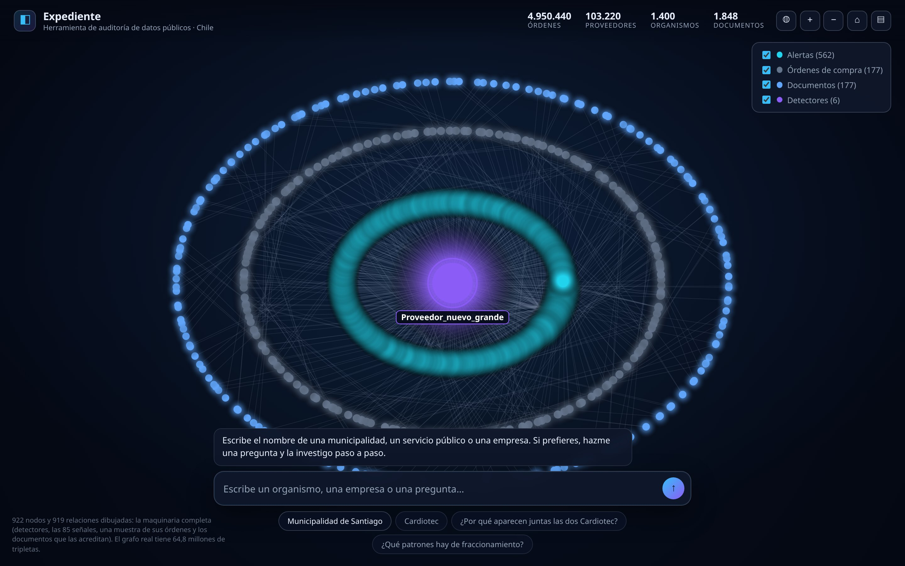

# Expediente

[](https://github.com/SebaWag/expediente/actions/workflows/ci.yml)
[](https://www.python.org/downloads/)
[](LICENSE)
[](pyproject.toml)

**A verifiable evidence engine for public procurement.**

> Every finding in an Expediente dossier is footnoted to the exact document and page.
> If a claim cannot be traced to a source, it is deleted, not softened.

Built for the **Meta Global AI Developer Hackathon 2026** (Startup track, theme *Build for Your World*).



<sub>The live portal at <a href="https://investiga.wagnersolutionsai.com">investiga.wagnersolutionsai.com</a> — 922 nodes drawn from a graph of 64.8 M triples, with the real totals beside them.</sub>

---

## The problem

Chile publishes the full lifecycle of every public purchase — tenders, purchase orders, agile
purchases, contracts — through Mercado Público's open API, and the Contraloría publishes its audit
findings. The data exists in public.

What does not exist is the ability to **connect** it and **prove** it. To answer one question —
*"why did this municipality buy the same thing six times this month from the same supplier?"* — an
auditor, a journalist or a council member must cross-reference hundreds of documents by hand, and
then convince someone else that the cross-reference is right.

The State already has anomaly alerts. The gap is not detection. **The gap is a chain of evidence
that a human can sign.**

## What it does

Give it one entity — a buyer unit, a supplier, a tender — and it returns a dossier where every
claim carries a citation:

1. **Ingest** public records into a property graph (`:Organismo`, `:OrdenCompra`, `:Proveedor`,
   `:CompraAgil`, `:Licitacion`, `:Documento`, `:Evidencia`).
2. **Resolve entities** — the same supplier appears with RUT variants, punctuation differences,
   shared addresses and shared legal representatives. Resolution is a graph problem, not a string
   problem.
3. **Run deterministic detectors** — purchase splitting just below the bidding threshold, spend
   concentration, atypical direct awards, post-award contract growth, supplier co-bidding networks.
   A detector is a rule, and a rule is explainable and citable.
4. **Trace every finding** back to its source document and page, and drop the ones that cannot be
   traced.
5. **Benchmark against ground truth** — the Contraloría's published audit findings. *"The system
   independently rediscovered N of the M irregularities in report X, with correct citations."*

## Not a retrieval system. A navigation agent.

To be unambiguous: there is **no chunking, no embedding index, no vector store and no "ask the
documents" surface anywhere in this repository.** That architecture answers *"which paragraph
mentions X"*, which is not the question an auditor has.

Expediente is a **navigation agent**. It walks across datasets that were never joined, follows
typed edges between them, and produces the one thing none of those datasets contains on its own:
**a relation, with a citation**.

The datasets are all public. The joins are not:

| Dataset | Publisher | Joined to the rest today? |
|---|---|---|
| Purchase orders | ChileCompra | only by order code, inside its own file |
| `Compra Ágil` — including who quoted | ChileCompra | only by order code |
| Tenders and awards | ChileCompra | by tender code, when one exists |
| Contracts and modifications | ChileCompra | partially |
| Audit findings | Contraloría | **not at all** — PDFs, no identifiers |
| Ownership, legal representatives, addresses | company registries | **not at all** |

Nobody joins them because the join is not a foreign key. It is a **person** who appears as legal
representative of two suppliers. An **address** shared by three RUTs. A **sequence in time** —
seven orders that only mean something read together. Each of those requires a different kind of
traversal, and none of them is a similarity search over text.

So the agent has exactly three verbs:

| Verb | What it does | Why a retrieval system cannot |
|---|---|---|
| **Navigate** | chooses which edge to walk, and returns the path | a vector index has no edges to walk |
| **Relate** | asserts the connection between records that never referenced each other | similarity is not a relation |
| **Document** | attaches a document and a page to every assertion, or deletes the assertion | a chunk has a text span, not an accountable citation |

The path is the answer:

> A spreadsheet answers *how much*. A vector store answers *which text looks similar*.
> A graph answers **through whom** — and only that answer can be signed.

## Architecture

Frontier models only where they add something. Everything else is code.

| Layer | Runs on | Share of calls | Job |
|---|---|---|---|
| **0 · Deterministic** | Python + graph store | — | Ingest, normalise, detectors, aggregation, paths. Free, 100% citable. |
| **1 · Vision / OCR** | Meta SAM 3.1 + vision | small | Only pages with no text layer. |
| **2a · Extraction** | Meta open weights (Muse Spark Open) | volume | Document → structured rows. Throughput is the whole constraint. |
| **2b · Agent** | Muse Spark, `reasoning_effort=low` | narrow | Chooses which graph query to run. Does not write prose. |
| **3 · Reasoning** | Muse Spark, `reasoning_effort=high` | ~5% | Synthesis of the dossier. One call per case. |

Two rules hold the design together:

- **The model returns data, never decisions.** Layer 2a turns a document into rows. Deterministic
  code decides what counts as an anomaly. No detector output can be hallucinated.
- **Prompt caching is a design constraint.** Tool schemas and the system prompt are stable so the
  cached prefix stays hot across turns.

## Graph model

See [`docs/GRAPH_SCHEMA.md`](docs/GRAPH_SCHEMA.md) for the full node and edge vocabulary.
The invariant that matters:

```
(:Afirmacion)-[:SOPORTADA_POR]->(:Evidencia)-[:EN]->(:Documento)
```

Any `:Afirmacion` without a path to a `:Documento` with a page number is **removed before export**.

## Repository layout

```
expediente/
  domain/       pure models and normalisers (no I/O, no network)
  ingest/       Mercado Público v1 + v2 clients, OCDS, bulk loaders
  graph/        graph schema, store interface, MillenniumDB adapter
  navigate/     RPQ route expressions and the tools an agent can call
  resolution/   entity resolution: shared address, shared representative
  detectors/    deterministic, explainable rules
  evidence/     the gate: what a dossier is allowed to say, PDF -> page
  dossier/      the signed artifact: citations, rejections, limitations
  agent/        the navigation agent: verbs, provider, plan/act/observe loop
  runs/         the append-only recording of a run, and its replay
  research/     web search, fetch, and the quote-must-exist rule
  mcp/          the graph tools, exposed over MCP for an external agent
  api/          the same tools over read-only HTTP
  portal/       the investigation UI: map, board, agent, log
  cli.py        command line entry point
scripts/        isolated MillenniumDB, ingest, deploy, signal materialisation
benchmarks/     the entity-resolution set: 1,249 pairs labelled by RUT
docs/           architecture, graph schema, backend dialect, findings
tests/          unit tests, deterministic, offline
examples/       small synthetic fixtures (fake data, clearly labelled)
```

## Quickstart

No dependencies. Python 3.11+ and the standard library are enough to run the deterministic core
and the tests:

```bash
git clone https://github.com/SebaWag/expediente
cd expediente

python3 -m pytest tests/ -q            # or: python3 -m unittest discover -s tests
python3 -m expediente.cli detect --input examples/oc_synthetic.json --ceiling 1000000
python3 -m expediente.cli gate   --input examples/dossier_synthetic.json
python3 -m expediente.cli dossier --input examples/dossier_synthetic.json \
        --out out/caso.md --generado 2026-10-27
```

The export in [`examples/dossier_export_sample.md`](examples/dossier_export_sample.md) is
what comes out of that command.

The whole chain, from records to a signable document, is one command:

```bash
python3 -m expediente.cli investigate --key 11111111-1 \
        --out examples/investigation_sample.md --generado 2026-10-27
```


## Where it runs

| Surface | URL | Notes |
|---|---|---|
| **Investigation portal** | `https://investiga.wagnersolutionsai.com` | map, board, agent, log. Separate process: this one writes |
| Graph API (read-only) | `https://expediente.wagnersolutionsai.com/health` | 8 endpoints, TLS, no write path in the process |
| MillenniumDB | loopback only, inside the host | the engine speaks update; the API does not |

The portal and the API are different containers on purpose. The API is read-only by
construction — the store is only ever asked `select` — and that is what makes the
sentence *"exposing this on the internet cannot write to the graph"* true. The portal
writes runs, event logs and dossiers, so it cannot live there. See
[`docs/PORTAL.md`](docs/PORTAL.md).

```bash
curl https://expediente.wagnersolutionsai.com/stats
curl https://expediente.wagnersolutionsai.com/network/76.264.138-0
```

The MCP server runs anywhere the agent runs; it speaks stdio and asks the same
functions the HTTP API asks:

```bash
EXPEDIENTE_MDB_URL=http://127.0.0.1:1234 python3 -m expediente.mcp.server
```

Talking to Mercado Público needs a free ticket (requested at
`api.mercadopublico.cl`, arrives by email):

```bash
cp .env.example .env        # then put your ticket in MP_TICKET
python3 -m expediente.cli fetch-agil --desde 2026-10-20 --out data/agil.json
```

## Status

Honest as of **day 4** (2026-10-29). **51 commits, 264 tests** — and both runs are
reproduced on every push by CI, not by a badge that only claims it:

```bash
python3 -m pytest -q            # 257 passed, 7 skipped (the engine tests need a server)
EXPEDIENTE_MDB_URL=http://127.0.0.1:1234 python3 -m pytest -q   # 264 passed
```

The `graph` job in [`.github/workflows/ci.yml`](.github/workflows/ci.yml) starts an
isolated MillenniumDB and runs the second command, so the differential test — the one
that says the in-memory adapter and the engine agree — is executed, not skipped.

| Component | State |
|---|---|
| Domain models + normalisers (RUT, legal name, CLP, periods, addresses) | ✅ working, tested |
| Graph schema (16 node labels, 23 edges, evidence invariant) | ✅ defined, and the docs are generated from it |
| Graph store — in memory | ✅ reference adapter, used by the tests |
| Graph store — **MillenniumDB** | ✅ **in production**: 64.8 M triples on v1.0.0, per-edge provenance, native property paths |
| Ingestion — ChileCompra bulk, 5 years | ✅ **4,950,443 purchase orders** from 129 archives (13,368,668 rows). 48 orders carry two different amounts; that is kept as a data-quality finding, not smoothed away |
| Ingestion — Compra Ágil (live API) | ✅ working, including the list of who quoted each purchase |
| Ingestion — OCDS supplier registry | ✅ 99.9 % of suppliers expose an address the bulk does not have; 87.5 % joined to the graph once the RUT format bug was fixed |
| Document layer — PDF → page | ✅ reads a PDF and returns the page a quote came from, so a page number is measured, never typed |
| Detector 1 — purchase splitting | ✅ working, tested |
| Detector 2 — spend concentration (HHI) | ✅ working, tested |
| Detector 3 — suppliers that always quote together | ✅ working, tested |
| Detector 4/5 — late modification and cancellation | ✅ working, tested |
| Supplier network — shared address, as a **traversal** | ✅ 741 addresses, 754 edges, 14 shared-address pairs in production. Deliberately **not** a `:Senal`: a shared address is also what an office building looks like, so it is a path a human walks, not a finding the system asserts |
| Evidence gate (claims without a document and a page are deleted) | ✅ working, tested |
| Route expressions (RPQ) with inverse, concatenation and alternation | ✅ working, and evaluated natively by the engine |
| Dossier export — markdown + JSON, content-derived id | ✅ working, tested |
| End-to-end pipeline — detect → cite from the graph → gate → dossier | ✅ working, tested |
| **Entity resolution — shared address / shared representative** | ✅ built **and measured** — see below |
| **MCP server — 5 graph tools over stdio** | ✅ working, tested |
| **Read-only HTTP API — 8 endpoints** | ✅ deployed with TLS |
| **Navigation agent — 9 named verbs, natural language in** | ✅ live: `muse-spark-1.3`, plan/act/observe, budgets in code. A live run resolves the star case in 8 steps and 24 s, with the caveat travelling next to the claim |
| **Web research with traceability** | ✅ a claim needs a verbatim quote found at an offset in the bytes we fetched; paraphrases are rejected with a reason |
| **Run recording — append-only log + replay** | ✅ the dossier can be rebuilt from the recording with no model, no network and no database |
| **Portal — map, board, agent, log** | ✅ `investiga.wagnersolutionsai.com`, no build step, no dependency |
| Contraloría benchmark — recall against published findings | ⬜ **not started**, and the reason is recorded: that corpus is not machine-readable (Liferay portlet over AJAX, no dataset on datos.gob.cl — checked 2026-10-29) |
| **Detector desk check — 48 findings, re-derived** | ✅ **{int(79)}% actionable, 100% reproduce their own definition, 83% with complete evidence**. Three rule defects found and fixed. See [`docs/BENCHMARK.md`](docs/BENCHMARK.md) |
| Vision / OCR — Meta SAM 3.1, for pages with no text layer | ⬜ not started |

### Entity resolution was not tuned. It was measured.

The bulk of ChileCompra contains **no supplier address (0 %)** and **no legal
representative (0 %)** — the two relations the resolver asserts. So the detector that
needs them was returning zero findings, and that was not an oversight, it was an empty
input. `api.mercadopublico.cl/…/Empresas.json` answers HTTP 500 to every variant;
`opendata.portaltransparencia.cl` answers 403. The OCDS endpoint
(`api.mercadopublico.cl/APISOCDS/OCDS/`) carries the address and needs no ticket.

With a source in hand, the threshold question was answered with a labelled set rather
than a guess. Labels come from the **RUT**, not from a model — two strings sharing an
`identifier.id` are the same legal entity by definition, so there is no circularity:

| Stage | Threshold | Precision | Recall |
|---|---|---|---|
| Embeddings only (`qwen3-embedding-8b`) | cos ≥ 0.86 | **0 of 150** hard negatives rejected — unusable alone | — |
| Reranker (`qwen3-reranker-8b`) — candidate | 0.30 | 0.925 | 0.634 |
| Reranker — asserted relation | 0.90 | **0.991** | 0.226 |

Naming a *candidate* and asserting a *relation* are different acts with different costs.
A false candidate costs a human two minutes. A false relation is a false accusation. So
there are two thresholds, and the dossier only ever asserts the second.

The hard case that justifies the whole pipeline:

```
cos = 0.9703    TERUMO BCT CHILE S.A.   ↔   TERUMO CHILE LTDA
```

Same corporate group, two legal entities. No similarity threshold separates them; a
relation between them would be wrong. Full write-up in
[`docs/ENTITY_BENCHMARK.md`](docs/ENTITY_BENCHMARK.md).

## Built during the hackathon

The hackathon rules require new work built inside the event window, and require contributors to be
identifiable. Both are handled by the commit history rather than by a slide:

- The first commit in this repository is dated **2026-10-27**, after the 2026-10-26 kickoff.
- No code in this repository predates the event window. Nothing was copied from earlier private
  projects; where a technique was already known, it was rewritten here, in this history.

## Third-party components

| Component | License | Used for |
|---|---|---|
| Python standard library only | PSF | everything except the optional PDF extractors |
| Mercado Público open API / open data | public data | source records |
| MillenniumDB | GPL-3.0 | property graph store (in production, 64.8 M triples) |
| Meta Model API (Muse Spark, SAM 3.1) | — | layers 1, 2a, 2b, 3 |

## Legal framing

Expediente does not accuse anyone of anything. It reports relationships present in public data and
cites the document each one comes from. Findings are descriptive statements about records, not
allegations about people or companies. The intended output is a dossier a human reviews, verifies
and signs — never an automatic verdict.

## License

MIT — see [LICENSE](LICENSE).
